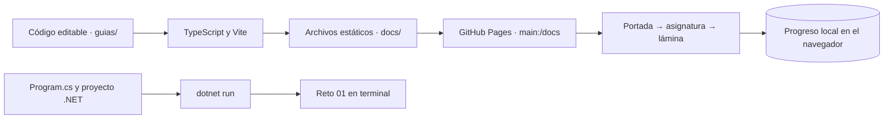

<div align="center">

# Retos y cuaderno de estudio · DAM

**Guías interactivas y proyectos de consola para estudiar 1.º de Desarrollo de Aplicaciones Multiplataforma.**

Material de Synji · DigitalSynapse para repasar con compañeros y seguir ampliando el cuaderno a medida que avance el curso.

    

[Abrir el cuaderno](https://splurtch.github.io/retos_programacion_dam/) · [Explorar el Reto 01](reto-01-iva-financiacion/README.md) · [Actualizar las guías](guias/README.md)

</div>

---

## 1. El proyecto en un minuto

Si vienes a estudiar, abre el cuaderno, elige una asignatura y empieza por una lámina. Cada guía reúne explicaciones, ejemplos interactivos, autoevaluaciones, un glosario y un diario de clases. Las tres guías actuales cubren la **Unidad 1**. El botón **Asignaturas** vuelve a la portada desde cualquier lámina.

Si vienes a ver código, puedes abrir el proyecto de C# y ejecutar en tu terminal el **Reto 01 de IVA y financiación**. Su README explica cómo probarlo e incluye el diagrama de decisiones del programa.

## 2. Qué puedes encontrar

| Asignatura | Qué puedes repasar | Acceso |
|---|---|---|
| 0483 · Sistemas informáticos | Arquitectura, procesador, memoria, almacenamiento, montaje y virtualización. Incluye calculadoras y una guía para preparar el primer reto. | [Abrir guía](https://splurtch.github.io/retos_programacion_dam/sistemas-informaticos/) |
| 0484 · Bases de datos | Datos, ficheros, SGBD y modelo entidad-relación. Incluye ejercicios visuales de entidades, atributos y cardinalidades. | [Abrir guía](https://splurtch.github.io/retos_programacion_dam/bases-de-datos/) |
| 0485 · Programación | Algoritmos, diagramas, variables, operadores, decisiones, bucles y errores. Incluye simulaciones paso a paso con código, memoria y consola. | [Abrir guía](https://splurtch.github.io/retos_programacion_dam/programacion/) |
| Reto 01 · IVA y financiación | Aplicación de consola que calcula IVA y, a partir de 500 € con IVA, permite simular una compra financiada a 3, 6 o 12 meses. | [Uso y diagrama de flujo](reto-01-iva-financiacion/README.md) · [Código](reto-01-iva-financiacion/Program.cs) |

Cada guía guarda el progreso en el almacenamiento local del navegador, con claves por asignatura. El cuaderno funciona sin cuenta. Los enlaces de las láminas usan rutas con `#` y se pueden compartir directamente.

## 3. Arquitectura



La portada vive en `guias/programacion/src/Portada.tsx`. Comparte estilos, tarjetas, selector de tema y pie con la guía de C#. Cada asignatura tiene su propia aplicación y registra sus láminas en `src/laminas/index.ts`. La compilación web se guarda en `docs/`, que es la carpeta servida por Pages.

## 4. Con qué está hecho

| Tecnología | Para qué se usa |
|---|---|
| React 19 y TypeScript 7 | Portada, láminas, glosarios, simuladores y validación de tipos. |
| Astryx 0.7.16, CSS y Fontsource | Componentes de interfaz, temas, estilos y fuentes alojadas con el sitio. |
| Node.js 24 y npm | Instalación con archivo de bloqueo y ejecución de pruebas con `node --test`. |
| Vite 8 | Servidor de desarrollo y compilación de cada guía para GitHub Pages. |
| C# y SDK de .NET 10 | Aplicación de consola del Reto 01. |
| GitHub Pages | Alojamiento estático de la portada y las guías. |

## 5. Organización

```text
retos_programacion_dam/
├── guias/                             # Código editable de las guías
│   ├── sistemas-informaticos/
│   ├── bases-de-datos/
│   ├── programacion/                  # Incluye el código de la portada
│   └── README.md                      # Compilar y ampliar el cuaderno
├── docs/                              # Sitio compilado para GitHub Pages
├── reto-01-iva-financiacion/           # Aplicación C# y documentación del reto
├── SUBIR_A_GITHUB.md                   # Guía de Git del proyecto
└── README.md
```

## 6. Ejecutarlo en local

Clona el repositorio y entra en él.

```bash
git clone https://github.com/Splurtch/retos_programacion_dam.git
cd retos_programacion_dam
```

| Quiero… | Comando |
|---|---|
| Ver la portada y las tres guías compiladas, con Python 3 | `python3 -m http.server --directory docs` y abrir `http://localhost:8000`. |
| Editar una guía, con Node.js 24 | Entrar en su carpeta bajo `guias/` y ejecutar `npm ci --ignore-scripts` y `npm run dev`. |
| Ejecutar las pruebas de una guía | Desde su carpeta, ejecutar `node --test 'src/**/*.test.ts'`. |
| Probar el reto, con SDK de .NET 10 | Desde la raíz, ejecutar `dotnet run --project reto-01-iva-financiacion/PrimerCSharp..csproj`. |

Los comandos de compilación y ampliación están en el [manual de las guías](guias/README.md).

## 7. Estado y alcance

- **Implementación.** Tres guías de la Unidad 1, una portada común y un reto ejecutable de consola.
- **Pruebas.** Las guías tienen pruebas de cálculo y simulación. El reto documenta sus validaciones y limitaciones en su propio README.
- **Publicación.** La versión web está disponible en GitHub Pages. Los cambios en `main:/docs` actualizan el sitio.
- **Material compartido.** El repositorio publica apuntes, guías y código de elaboración propia. Los documentos del campus y los archivos personales se conservan fuera del repositorio.
- **Uso educativo.** El cuaderno complementa el estudio y las entregas del curso. El cálculo financiero del reto es un ejercicio didáctico. El repositorio no declara una licencia de reutilización.

## 8. Documentación relacionada

- [Guías · desarrollo, compilación y nuevas láminas](guias/README.md)
- [Reto 01 · ejecución, decisiones y limitaciones](reto-01-iva-financiacion/README.md)
- [Guía de actualizaciones con Git](SUBIR_A_GITHUB.md)
