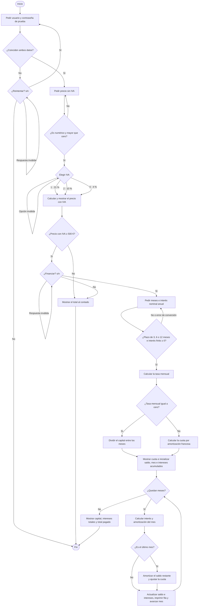

<div align="center">

# Reto 01 · IVA y financiación

**Una aplicación de consola en C# que calcula el precio con IVA y simula el pago al contado o a plazos.**

  

[Ver el código](Program.cs) · [Diagrama de flujo](#3-diagrama-de-flujo) · [Ejecutar en local](#5-ejecutar-en-local) · [Volver al repositorio](../README.md)

</div>

---

## 1. El reto en un minuto

Introduces un precio base y eliges el IVA. El programa muestra el precio final y, desde **500 € con IVA**, pregunta si quieres financiarlo. Si eliges pagar a plazos, puedes escoger **3, 6 o 12 meses** e introducir el interés nominal anual. La consola muestra la cuota, el desglose de cada mes y el total pagado.

| Entrada | Decisión o cálculo | Salida |
|---|---|---|
| Usuario y contraseña de prueba | Comprueba ambos valores y permite reintentar o salir. | Acceso al cálculo o fin del programa. |
| Precio base e IVA | Aplica el 21 %, 10 % o 4 % según la opción elegida. | Precio con IVA, mostrado con dos decimales. |
| Importe final y elección de pago | Desde 500 € ofrece financiación. | Total al contado o entrada al cálculo a plazos. |
| Meses e interés nominal anual | Divide el capital a interés cero o aplica amortización francesa. | Cuota, intereses, amortización, saldo y total pagado. |

## 2. Cómo está hecho

El flujo se ejecuta en `Main` dentro de [Program.cs](Program.cs). Usa constantes para los tipos de IVA, un `switch` para seleccionar el porcentaje, bucles para repetir entradas y `Math.Pow` para calcular la cuota con interés. Las entradas y salidas pasan por `Console.ReadLine` y `Console.WriteLine`. El proyecto [PrimerCSharp..csproj](PrimerCSharp..csproj) define el ejecutable para `net10.0`.

El interés mensual es el porcentaje anual dividido entre 12 y entre 100. Cada mes se calcula el interés sobre el saldo pendiente. El resto de la cuota amortiza capital. En el último mes, la amortización toma el saldo restante y la cuota se ajusta para liquidarlo.

## 3. Diagrama de flujo



## 4. Tecnologías y archivos

| Pieza | Qué contiene |
|---|---|
| [Program.cs](Program.cs) | Código C# del reto con entrada, validación, cálculo y salida en consola. |
| [PrimerCSharp..csproj](PrimerCSharp..csproj) | Proyecto de consola para el SDK de .NET 10. El nombre conserva los dos puntos antes de `csproj`. |
| [README.md](README.md) | Uso, diagrama de flujo y alcance del ejercicio. |

## 5. Ejecutar en local

Necesitas el **SDK de .NET 10**. Abre una terminal en la carpeta del reto.

```bash
dotnet run --project PrimerCSharp..csproj
```

Para compilar el proyecto por separado, usa `dotnet build PrimerCSharp..csproj`.

### Ejemplo con datos ficticios

| Paso | Escribe |
|---|---|
| Usuario y contraseña de prueba | `Usuario1` y `1234` |
| Precio sin IVA | `500` |
| Tipo de IVA | `1` para el 21 % |
| ¿Financiar? | `s` |
| Plazo e interés anual | `3` meses y `0` % |

El precio con IVA es **605,00 €**. La cuota se muestra como **201,67 €** con formato español, el interés total es **0,00 €** y el saldo final es **0,00 €**. Los separadores siguen la configuración regional del equipo. La tabla muestra dos decimales y el cálculo interno usa `double`.

## 6. Validaciones y limitaciones

- La contraseña es ficticia y el acceso sirve para practicar condicionales. El usuario distingue mayúsculas y minúsculas.
- Las preguntas de sí o no aceptan `s`, `S`, `n` y `N`. Se repiten las entradas incorrectas de IVA, precio, plazo e interés.
- El interés debe ser finito y mayor o igual a cero. Las conversiones de plazo e interés gestionan formato y desbordamiento.
- El precio base no comprueba expresamente que el valor sea finito. Las cantidades extremas y tasas muy pequeñas o muy grandes pueden afectar a la precisión.
- El fin de entrada de consola carece de una salida específica y puede provocar repeticiones. Las tabulaciones pueden desalinear columnas con importes largos.
- La compilación conserva cinco avisos CS8600 por lecturas de consola potencialmente nulas.

## 7. Estado y documentación

El repositorio conserva la versión de aprendizaje entregada. El ejercicio se ejecuta en la terminal y el [cuaderno web](https://splurtch.github.io/retos_programacion_dam/programacion/) ofrece láminas y simuladores para repasar los conceptos de C#.

[Volver al índice del repositorio](../README.md) · [Abrir la guía de C# en el navegador](https://splurtch.github.io/retos_programacion_dam/programacion/)
